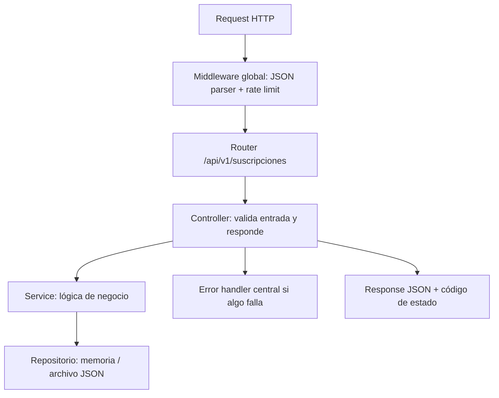
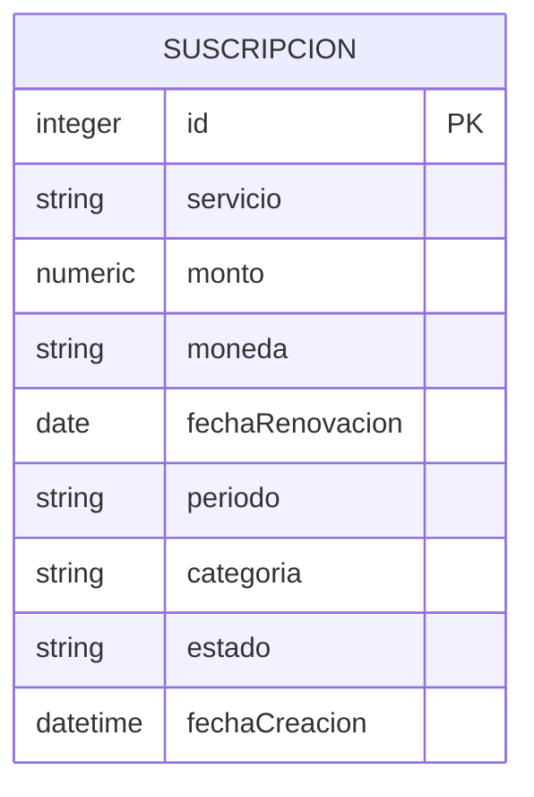
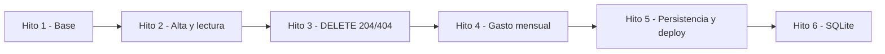

# SubsControl — API de Control de Suscripciones

## 💡 Idea central

Una API REST personal que registra todas las suscripciones de pago (Netflix, Spotify, dominios, hosting, membresías) para responder tres preguntas que casi nadie sabe contestar:

1. **¿Cuánto gasto al mes en suscripciones?**
2. **¿Cuándo renueva cada una?**
3. **¿Qué suscripción eliminé cuando la cancelé?**

La pieza central del proyecto es la ruta de eliminación: al cancelar una suscripción se envía su `id` en el body y la API regresa `204` si la elimina o `404` si no existe.

**Stack:** Node.js + Express. Datos en memoria (arreglo) al inicio, con ruta de migración definida: archivo JSON → SQLite. Estilo de la lección.

---

## 📋 Requerimientos funcionales

| ID | Requerimiento |
|----|---------------|
| RF-01 | Registrar una suscripción con: servicio, monto, moneda, fecha de renovación, período (semanal, mensual, anual), categoría y estado |
| RF-02 | Consultar todas las suscripciones registradas |
| RF-03 | Consultar una suscripción por su `id` |
| RF-04 | **Eliminar una suscripción**: DELETE recibe `id` en el body → `204` si existe y se elimina, `404` si no existe |
| RF-05 | Consultar solo suscripciones activas |
| RF-06 | Calcular el gasto mensual total estimado (anual y semanal convertidos a mensual) |
| RF-07 | Marcar una suscripción como cancelada sin eliminarla (distinguir "cancelada" de "eliminada por error") |
| RF-08 | Listar suscripciones que renuevan en los próximos 7 días |

## 🔒 Requerimientos no funcionales

| ID | Requerimiento |
|----|---------------|
| RNF-01 | Todas las respuestas son JSON, excepto `204` que no tiene cuerpo |
| RNF-02 | Códigos de estado HTTP correctos: `200`, `201`, `204`, `400`, `404` |
| RNF-03 | Validar campos obligatorios en POST: regresar `400` con mensaje de error |
| RNF-04 | El `id` se genera automáticamente y es único |
| RNF-05 | Proyecto versionado en Git con un commit por issue terminado |
| RNF-06 | Latencia objetivo: p95 < 50 ms en lectura con datos en memoria |
| RNF-07 | Rate limiting activo en producción: `429` al exceder el límite |
| RNF-08 | Rutas en español, plural, kebab-case; campos JSON en camelCase; errores con formato único |

---

## 🏗️ Arquitectura, resiliencia y convenciones

### Patrón elegido: arquitectura en capas con el patrón Router de Express

**Decisión:** capas ligeras (routes → controllers → services → repositorio) montadas con `express.Router()`. Flujo de una petición:



Estructura de carpetas:

```text
src/
├── app.js                      # bootstrap: Express + middleware global
├── routes/
│   └── suscripciones.routes.js
├── controllers/
│   └── suscripciones.controller.js
├── services/
│   └── suscripciones.service.js
├── data/
│   └── suscripciones.repository.js   # Hito 5: agrega persistencia en JSON
└── middleware/
    ├── errorHandler.js
    ├── logDuracion.js
    └── rateLimit.js
```

**Por qué este patrón:**

| Alternativa | Veredicto | Razón |
|-------------|-----------|-------|
| Capas + Router (elegida) | ✅ | La lógica de negocio (gasto mensual, ventana de 7 días) queda aislada y testeable sin HTTP; `express.Router()` organiza las rutas sin inflar `app.js` |
| Todo en `app.js` | ❌ | Con 9 endpoints aún se sostiene, pero mezcla validación, lógica y acceso a datos en un archivo que se vuelve frágil al crecer |
| MVC completo | ❌ | La V de MVC no existe en una API REST: no hay vistas, solo controllers y services |
| DDD / microservicios | ❌ | Un solo dominio (suscripciones) y un solo usuario: la complejidad extra no aporta nada hoy, y las capas permiten migrar después sin reescribir |

**Reglas de la casa:** routes no conoce lógica de negocio; services no conoce Express (no importa `req`/`res`); solo el repositorio toca los datos.

### Resiliencia

| Mecanismo | Decisión |
|-----------|----------|
| Manejo de errores central | Middleware único al final de la cadena: cualquier error no manejado → `500` con `{ "error": "Error interno del servidor" }`. Una petición nunca crashea el proceso |
| Ruta no encontrada | Middleware después de las rutas → `404` con `{ "error": "Ruta no encontrada" }` |
| Fail fast | Validación de entrada al inicio del controller: datos inválidos se rechazan con `400` antes de tocar el servicio |
| Shutdown ordenado | Al recibir `SIGINT`/`SIGTERM`: cerrar el servidor y (desde Hito 5) volcar el JSON antes de salir |
| Timeouts | `server.timeout` de 10 s — ninguna ruta hace trabajo que lo alcance con datos en memoria |
| Retry / circuit breaker | **No aplica en v1**: no hay servicios externos. Se vuelven requisito si se agregan pagos o correos |

### Latencia

| Aspecto | Decisión |
|---------|----------|
| Objetivo (RNF-06) | p95 < 50 ms en lectura; < 100 ms con persistencia de archivo |
| Datos en memoria | Operaciones sobre arreglos son submilisegundo: no se necesita caché |
| Persistencia (Hito 5) | Escritura asíncrona con `fs/promises`; nunca `writeFileSync` (bloquea el event loop) |
| Verificación | Middleware `logDuracion` que registra método, ruta, milisegundos y código de estado en cada petición |

### Rate limiting

- **Librería:** `express-rate-limit` (estándar de facto, sin configuración externa)
- **Alcance:** activo solo en producción (Hito 5); en local se deshabilita para no estorbar las pruebas con Bruno
- **Límites asimétricos:** GET 100 peticiones / 15 min; POST, PATCH y DELETE 30 / 15 min — quien consulta gasta poco, quien escribe puede dañar datos
- **Al exceder:** `429` con `{ "error": "Demasiadas peticiones, intenta más tarde" }` más los headers estándar (`RateLimit-*`, `Retry-After`) que la librería agrega sola
- **Unidad:** por IP en v1 (no hay usuarios); cuando haya autenticación, el límite migra a por usuario

### Convenciones de diseño

| Tema | Convención | Estado en el plan |
|------|-----------|-------------------|
| Recursos | Sustantivos en plural, español, kebab-case | `/suscripciones`, `/gasto-mensual` ✓ |
| Métodos HTTP | El verbo va en el método, no en la URL: GET lee, POST crea, PATCH cambia estado, DELETE elimina | ✓ |
| Campos JSON | camelCase | `fechaRenovacion` ✓ |
| Errores | Siempre `{ "error": "mensaje" }`, sin excepciones | ✓ |
| Versionado | Prefijo global `/api/v1/suscripciones` | Se define en Hito 1 y se monta en Hito 2 |
| Idempotencia | DELETE y PATCH-cancelar son idempotentes: repetirlos no daña datos | ✓ |
| Acciones no-CRUD | Sub-recurso con nombre de negocio, no verbo en URL: `/gasto-mensual` y no `/calcularGasto` | ✓ |
| Paginación | Fuera de alcance v1 (lista pequeña); preparada para `?pagina=&limite=` | v2 |

---

## 🗄️ Modelo de datos y base de datos

### Ruta de migración del almacenamiento

| Etapa | Almacenamiento | Cuándo | Por qué |
|-------|---------------|--------|---------|
| v1 (Hitos 1–4) | Arreglo en memoria | Desde el día 1 | Como la lección; se reinicia y se pierde todo, aceptable mientras se desarrolla |
| Hito 5 | Archivo JSON (`data/suscripciones.json`) | Al desplegar | Los datos sobreviven reinicios sin agregar dependencias |
| Hito 6 | SQLite (`better-sqlite3`) | Al querer filtros e historial real | Base de datos SQL sin servidor: un solo archivo, consultas reales, y práctica transferible al trabajo |

**Por qué no PostgreSQL ni MongoDB en v1:** requieren un servidor de base de datos corriendo aparte — demasiada operación para una API personal. SQLite da transacciones, CHECKs y SQL real con cero infraestructura, y migrar a Postgres después es solo cambiar el repositorio otra vez.

**La clave que hace posible la migración:** el patrón de repositorio (sección de arquitectura). Controllers y services nunca tocan los datos directamente; consumen un contrato:

```text
obtenerTodas() → Suscripcion[]
obtenerPorId(id) → Suscripcion | null
crear(datos) → Suscripcion           // genera id
eliminar(id) → boolean               // true = existía, false = 404
marcarCancelada(id) → Suscripcion | null
```

Cambiar de memoria a JSON a SQLite es reescribir **un solo archivo** (`suscripciones.repository.js`). Nada más se toca.

### Entidad Suscripcion

| Campo | Tipo | Restricciones | Descripción |
|-------|------|---------------|-------------|
| `id` | INTEGER autoincrement | PK, único, generado por el servidor | Nunca se reutiliza el de un eliminado |
| `servicio` | TEXT | Obligatorio, no vacío | "Netflix", "GoDaddy" |
| `monto` | NUMERIC | Obligatorio, ≥ 0 | 0 es válido (suscripción gratuita); negativo se rechaza |
| `moneda` | TEXT | Default `"MXN"` | Código ISO 4217 |
| `fechaRenovacion` | DATE | Obligatoria, formato `YYYY-MM-DD` | Sin horas, para evitar errores por zona horaria |
| `periodo` | TEXT | Obligatorio, `semanal` \| `mensual` \| `anual` | CHECK en la base de datos |
| `categoria` | TEXT | Opcional | "streaming", "dominio", "hosting" |
| `estado` | TEXT | Default `activa`, `activa` \| `cancelada` | Cancelada ≠ eliminada |
| `fechaCreacion` | DATETIME | Default ahora | Auditoría |



### Esquema SQL (Hito 6, SQLite)

```sql
CREATE TABLE suscripciones (
  id              INTEGER PRIMARY KEY AUTOINCREMENT,
  servicio        TEXT NOT NULL CHECK (servicio <> ''),
  monto           NUMERIC NOT NULL CHECK (monto >= 0),
  moneda          TEXT NOT NULL DEFAULT 'MXN',
  fecha_renovacion TEXT NOT NULL,  -- ISO YYYY-MM-DD
  periodo         TEXT NOT NULL CHECK (periodo IN ('semanal', 'mensual', 'anual')),
  categoria       TEXT,
  estado          TEXT NOT NULL DEFAULT 'activa' CHECK (estado IN ('activa', 'cancelada')),
  fecha_creacion  TEXT NOT NULL DEFAULT (datetime('now'))
);
```

Las reglas que hoy valida el controller en JS quedan respaldadas por `CHECK`s en la base: dos capas de defensa.

### Consulta que necesita cada endpoint

| Endpoint | Operación de datos |
|----------|-------------------|
| `GET /suscripciones` | `SELECT * ORDER BY fecha_renovacion` |
| `GET /suscripciones/:id` | `SELECT` por `id` → fila o nada (`404`) |
| `POST /suscripciones` | `INSERT` y regresar la fila con su `id` |
| `DELETE /suscripciones` | `DELETE` por `id` → si `changes === 0`, `404` |
| `GET /suscripciones/activas` | `WHERE estado = 'activa'` |
| `PATCH /suscripciones/:id` | `UPDATE estado = 'cancelada' WHERE id` |
| `GET /suscripciones/gasto-mensual` | `SUM(CASE periodo WHEN 'anual' THEN monto/12.0 WHEN 'semanal' THEN monto*4.33 ELSE monto END) WHERE estado = 'activa'` |
| `GET /suscripciones/proximas-renovaciones` | `WHERE fecha_renovacion BETWEEN hoy AND hoy+7 AND estado = 'activa'` |

Con una tabla de una persona el volumen es mínimo y no se necesitan índices; el ordenamiento por fecha y los CHECK sí importan porque definen comportamiento correcto, no rendimiento.

---

## 🚩 Hito 1 — Base del proyecto

**Objetivo:** servidor Express corriendo y verificable.

- [ ] **Issue 1.1** — Inicializar repositorio Git y proyecto Node (`npm init`)
- [ ] **Issue 1.2** — Instalar Express y crear `app.js` con el servidor escuchando en puerto 3000
- [ ] **Issue 1.3** — Crear ruta `GET /` de salud que regrese `{ "status": "ok" }`
- [ ] **Issue 1.4** — Crear `README.md` con el propósito del proyecto y cómo ejecutarlo
- [ ] **Issue 1.5** — Crear la estructura de carpetas por capas (`routes/`, `controllers/`, `services/`, `data/`, `middleware/`) según la arquitectura elegida
- [ ] **Issue 1.6** — Middleware central de manejo de errores: `404` de ruta no encontrada y `500` uniforme, y middleware `logDuracion` que registre método, ruta, ms y código de estado

**Criterio de aceptación:** `node app.js` levanta el servidor y `GET /` responde OK.

## 🚩 Hito 2 — Registro y lectura de suscripciones

**Objetivo:** poder dar de alta y consultar suscripciones.

- [ ] **Issue 2.1** — Definir el modelo de datos: arreglo `suscripciones` con objeto de ejemplo (id, servicio, monto, moneda, fechaRenovacion, periodo, categoria, estado)
- [ ] **Issue 2.2** — `POST /suscripciones`: crear suscripción generando `id` automático → `201` con la suscripción creada
- [ ] **Issue 2.3** — `POST /suscripciones`: validar campos obligatorios (servicio, monto, fechaRenovacion, periodo) → `400` si falta alguno
- [ ] **Issue 2.4** — `GET /suscripciones`: regresar todas las suscripciones → `200`
- [ ] **Issue 2.5** — `GET /suscripciones/:id`: regresar una suscripción por `id` → `200` o `404`
- [ ] **Issue 2.6** — Montar el router bajo el prefijo versionado `/api/v1/suscripciones` en `app.js`

**Criterio de aceptación:** con Bruno (o curl) se puede crear y consultar una suscripción de Netflix de ejemplo.

## 🚩 Hito 3 — Eliminación de suscripciones (requerimiento de la lección)

**Objetivo:** implementar la ruta DELETE con su semántica exacta.

- [ ] **Issue 3.1** — `DELETE /suscripciones`: recibir `id` en el body y eliminar la suscripción si existe → `204`
- [ ] **Issue 3.2** — `DELETE /suscripciones`: regresar `404` cuando el `id` no existe
- [ ] **Issue 3.3** — Probar con Bruno los 3 escenarios: eliminar existente (`204`), eliminar inexistente (`404`), eliminar ya eliminada (`404`)

**Criterio de aceptación:** eliminar una suscripción existente regresa `204` sin cuerpo; un `id` inexistente regresa `404`.

## 🚩 Hito 4 — Inteligencia de gasto

**Objetivo:** convertir el registro en información útil (RF-05 a RF-08).

- [ ] **Issue 4.1** — `GET /suscripciones/activas`: filtrar solo estado activo → `200`
- [ ] **Issue 4.2** — `PATCH /suscripciones/:id`: marcar suscripción como cancelada sin eliminarla → `200`
- [ ] **Issue 4.3** — `GET /suscripciones/gasto-mensual`: sumar todas las activas normalizadas a mensual (anual ÷ 12, semanal × 4.33) → `200` con `{ "totalMensual": ... }`
- [ ] **Issue 4.4** — `GET /suscripciones/proximas-renovaciones`: listar suscripciones activas que renuevan en los próximos 7 días → `200`

**Criterio de aceptación:** con 3 suscripciones de prueba (mensual, anual y semanal), el gasto mensual calculado es correcto.

## 🚩 Hito 5 — Persistencia y publicación

**Objetivo:** que los datos sobrevivan a reinicios y que la API sea usable desde cualquier dispositivo.

- [ ] **Issue 5.1** — Persistir las suscripciones en archivo JSON (leer al iniciar, escribir en cada cambio)
- [ ] **Issue 5.2** — Usar variables de entorno para el puerto (`process.env.PORT`)
- [ ] **Issue 5.3** — Crear colección de Bruno con todas las rutas y ejemplos (se guarda como archivos de texto, así que puede versionarse en Git junto al proyecto)
- [ ] **Issue 5.4** — Desplegar en un servicio gratuito (Render, Railway o Fly.io)
- [ ] **Issue 5.5** — Configurar rate limiting con `express-rate-limit`: GET 100/15 min, escrituras 30/15 min, `429` al exceder; deshabilitado en local
- [ ] **Issue 5.6** — Shutdown ordenado: al recibir `SIGINT`/`SIGTERM`, cerrar el servidor y volcar el JSON antes de salir

**Criterio de aceptación:** la API desplegada recuerda las suscripciones después de reiniciar el proceso.

## 🚩 Hito 6 — Base de datos real (SQLite)

**Objetivo:** reemplazar el JSON por una base de datos SQL sin reescribir la API.

- [ ] **Issue 6.1** — Instalar `better-sqlite3`, crear `suscripciones.db` y aplicar el esquema SQL de la sección de base de datos (tabla con sus `CHECK`s)
- [ ] **Issue 6.2** — Reescribir únicamente `suscripciones.repository.js` para usar SQL; la interfaz no cambia, controllers y services quedan intactos
- [ ] **Issue 6.3** — Crear script de migración de una sola ejecución: lee `suscripciones.json` e inserta cada registro en la tabla
- [ ] **Issue 6.4** — Mover el cálculo de `gasto-mensual` y `proximas-renovaciones` a SQL (`SUM` con `CASE`, `BETWEEN`)

**Criterio de aceptación:** los 9 endpoints responden exactamente igual que con el JSON (mismos códigos y cuerpos); el DELETE sigue regresando `204`/`404` según si la sentencia eliminó filas.

---

## ✅ Criterios de aceptación y casos límite por endpoint

> Convención general: todo error regresa JSON `{ "error": "mensaje descriptivo" }`. Cada criterio se verifica con la colección de Bruno (Issue 5.3).

### 1. `GET /` — Salud del servidor

**Criterios de aceptación:**
- Regresa `200` con `{ "status": "ok" }` sin importar el contenido de la base de datos
- Responde incluso si el arreglo de suscripciones está vacío o corrupto

**Casos límite:**

| Escenario | Comportamiento esperado |
|-----------|------------------------|
| Servidor recién iniciado, sin datos | `200` con `{"status":"ok"}` |

### 2. `POST /suscripciones` — Crear suscripción

**Criterios de aceptación:**
- Con body válido regresa `201` y la suscripción creada **incluyendo el `id` autogenerado**
- El `id` es único e incremental; nunca se reutiliza el de una suscripción eliminada
- Si falta un campo obligatorio (`servicio`, `monto`, `fechaRenovacion`, `periodo`) regresa `400` indicando **qué campo falta**
- La `fechaRenovacion` se guarda en formato ISO (`YYYY-MM-DD`)

**Casos límite:**

| Escenario | Comportamiento esperado |
|-----------|------------------------|
| Body vacío o JSON malformado | `400` con error descriptivo |
| Falta solo un campo obligatorio | `400` con `{ "error": "Falta el campo: monto" }` |
| `monto: "abc"` (no numérico) | `400` |
| `monto: -50` (negativo) | `400` |
| `monto: 0` (suscripción gratuita, ej. Google Drive) | `201` — cero es válido, solo negativo se rechaza |
| `periodo: "trimestral"` (no permitido) | `400` — solo `semanal`, `mensual`, `anual` |
| `fechaRenovacion: "32/13/2026"` (fecha inválida) | `400` |
| El cliente envía `id` en el body | Se ignora: el servidor siempre genera el suyo |
| `servicio: ""` (cadena vacía) | `400` |
| Mismo servicio registrado dos veces (dos cuentas de Netflix) | `201` — se permite en v1, documentado como política |

### 3. `GET /suscripciones` — Listar todas

**Criterios de aceptación:**
- Regresa `200` con el arreglo completo, siempre en JSON
- El arreglo va **dentro** de la respuesta (ej. `{ "suscripciones": [...] }` o arreglo directo), formato consistente en toda la API

**Casos límite:**

| Escenario | Comportamiento esperado |
|-----------|------------------------|
| No hay suscripciones registradas | `200` con `[]` — **nunca** `404` |
| Hay 1 sola suscripción | `200` con arreglo de un elemento |

### 4. `GET /suscripciones/:id` — Consultar una

**Criterios de aceptación:**
- Si existe regresa `200` con el objeto completo
- Si no existe regresa `404` con `{ "error": "Suscripción no encontrada" }`

**Casos límite:**

| Escenario | Comportamiento esperado |
|-----------|------------------------|
| `id` bien formado pero inexistente | `404` |
| `id` con formato inválido (`/suscripciones/abc`) | `404` en v1 (no se valida formato) |
| `id` de una suscripción ya eliminada | `404` |
| `id` con espacios o mayúsculas (`"A3 "` vs `"a3"`) | `404` — los id son exactos |

### 5. `DELETE /suscripciones` — Eliminar (requerimiento de la lección)

**Criterios de aceptación:**
- Recibe `{ "id": ... }` en el **body**
- Si existe: elimina del arreglo y regresa `204` **sin cuerpo**
- Si no existe: regresa `404` con `{ "error": "Suscripción no encontrada" }`
- La eliminación **no depende del estado**: una suscripción cancelada también se puede eliminar

**Casos límite:**

| Escenario | Comportamiento esperado |
|-----------|------------------------|
| Body sin `id` o vacío | `400` con `{ "error": "El id es obligatorio" }` |
| `id: null` o `id: undefined` | `400` |
| `id` llega como string (`"3"`) pero el arreglo lo guarda numérico | Normalizar con `Number(id)` antes de comparar → debe eliminarse correctamente, no dar un `404` falso |
| Eliminar la misma suscripción dos veces | Segunda llamada → `404` |
| Eliminar una suscripción cancelada (no activa) | `204` — el DELETE es independiente del estado |
| `id` existente pero con tipo mixto en el arreglo | Consistencia: el modelo define un solo tipo de `id` |

### 6. `GET /suscripciones/activas` — Solo activas

**Criterios de aceptación:**
- Regresa `200` solo con suscripciones en `estado: "activa"`
- Las canceladas y eliminadas no aparecen

**Casos límite:**

| Escenario | Comportamiento esperado |
|-----------|------------------------|
| Todas las suscripciones están canceladas | `200` con `[]`, no `404` |
| Una suscripción tiene estado desconocido (`"pausada"`) | Se excluye: solo `"activa"` cuenta |
| Mezcla de activas y canceladas | Solo regresan las activas, sin duplicados |

### 7. `PATCH /suscripciones/:id` — Cancelar (no eliminar)

**Criterios de aceptación:**
- Si existe: cambia `estado` a `"cancelada"` y regresa `200` con el objeto actualizado
- Si no existe: `404`
- **Solo modifica el estado**; ningún otro campo cambia

**Casos límite:**

| Escenario | Comportamiento esperado |
|-----------|------------------------|
| Cancelar una ya cancelada | `200` idempotente — no es error, el estado ya es el objetivo |
| `id` inexistente | `404` |
| Body con campos extra (`{ "monto": 999 }`) | Se ignoran: la ruta solo fija el estado |
| Body que intenta reactivar (`{ "estado": "activa" }`) | `400` en v1 — reactivar queda fuera de alcance, documentado |

### 8. `GET /suscripciones/gasto-mensual` — Total mensual

**Criterios de aceptación:**
- Regresa `200` con `{ "totalMensual": <número> }`
- Suma **solo activas**, normalizando período: anual ÷ 12, semanal × 4.33, mensual tal cual
- El resultado se redondea a 2 decimales

**Casos límite:**

| Escenario | Comportamiento esperado |
|-----------|------------------------|
| Sin suscripciones o todas canceladas | `200` con `{ "totalMensual": 0 }` |
| Solo una anual de $1200 MXN | `{ "totalMensual": 100 }` |
| Precisión decimal (`0.1 + 0.2` en JS da `0.30000000000000004`) | Redondeo a 2 decimales: `0.30` |
| Suscripción gratuita (`monto: 0`) | Se incluye sin romper la suma |
| Suscripciones en monedas distintas (MXN y USD) | ⚠️ Decisión pendiente: v1 documenta que la suma asume una sola moneda; conversión queda para v2 |

### 9. `GET /suscripciones/proximas-renovaciones` — Renuevan en 7 días

**Criterios de aceptación:**
- Regresa `200` con las activas cuya `fechaRenovacion` cae en la ventana `[hoy, hoy + 7 días]` (inclusivo en ambos extremos)
- Solo considera suscripciones activas
- La comparación usa solo la fecha (`YYYY-MM-DD`), sin horas, para evitar errores por zona horaria

**Casos límite:**

| Escenario | Comportamiento esperado |
|-----------|------------------------|
| Ninguna renovación en rango | `200` con `[]` |
| Renovación exactamente hoy | Se incluye (límite inferior inclusivo) |
| Renovación exactamente a 7 días | Se incluye (límite superior inclusivo) — decidido y documentado |
| Renovación hace 3 días (ya venció) | Se excluye en v1; listar vencidas queda como mejora futura |
| Todas las próximas están canceladas | `200` con `[]` — las canceladas no renuevan |

---

## 🗺️ Flujo de trabajo sugerido



## 📌 Nota de diseño

La distinción entre **cancelar** (Hito 4, PATCH: la suscripción queda registrada como cancelada) y **eliminar** (Hito 3, DELETE: desaparece del registro) es deliberada: en una app real querrías conservar el historial de qué servicios tuviste. Es exactamente el tipo de decisión de negocio que se discute en equipos de desarrollo.
